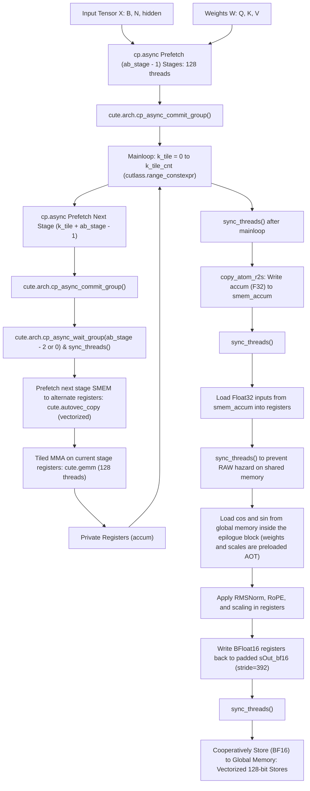
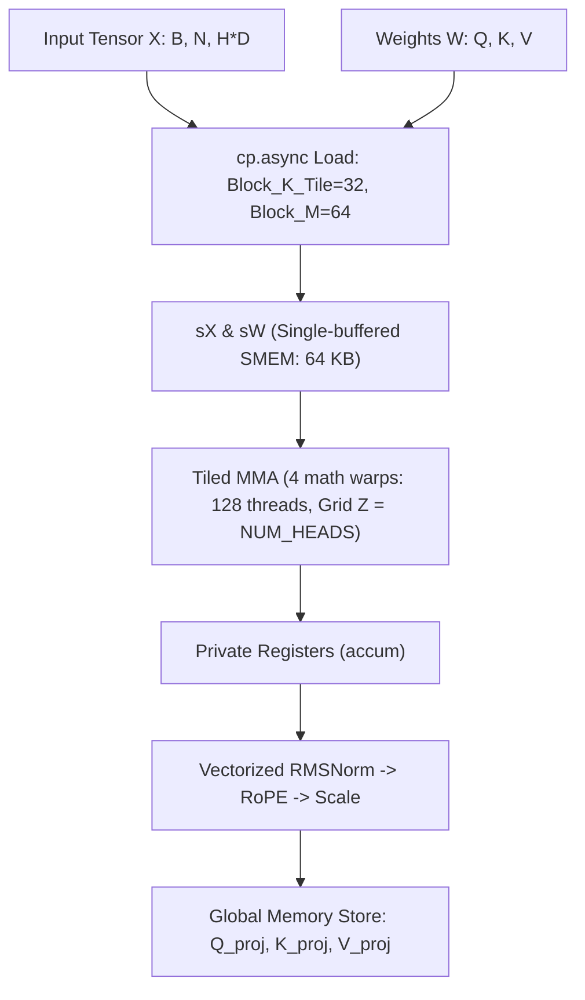
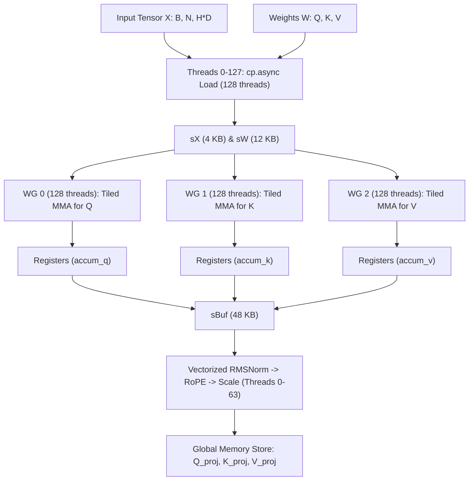
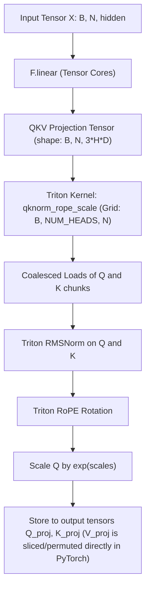
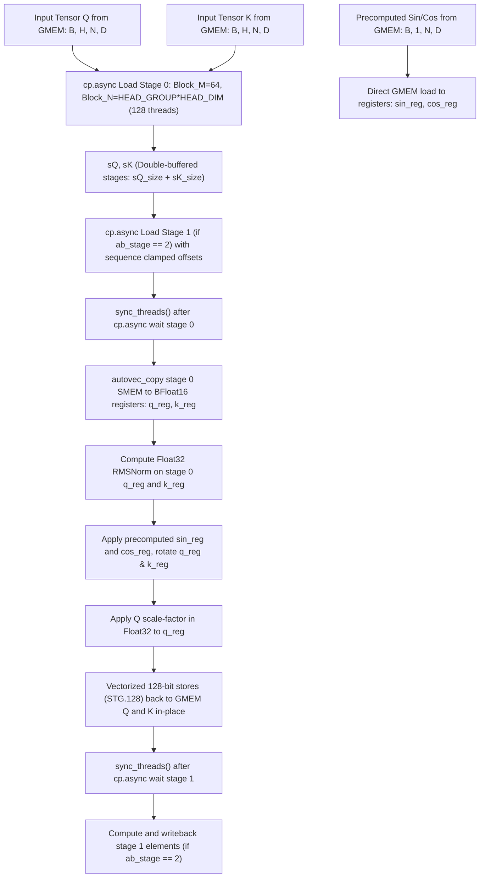

# Project Technical Architecture

## Module Boundaries

The project is structured as a modular Python library with clear separation between the custom CuTe-based fused projection kernels, the Triton epilogue, and the pipelined cp.async GEMM:

1. **CuTe DSL Fused Milestone 1 Kernel (`flash_attn_prologue/fused_pipelined_kernel.py`):**
   - Implements a fused QKV projection kernel doing double-buffered cp.async GEMM, sequence-level RMSNorm reduction, Rotary Position Embedding (RoPE) rotations, and query scaling entirely in registers.
   - Leverages a flat aligned Float32 shared memory layout with manual offset calculation and pointer casting (`recast_ptr`) to optimize occupancy and prevent layout JIT compile bugs.
   - Registers under `flash_prologue::fused_qkv_pipelined_cute` with PyTorch.
2. **CuTe DSL Fused Kernel (`flash_attn_prologue/kernel.py`):**
   - Entry point for the JIT-compiled custom CUDA kernel using CuTe Python DSL (`cutlass.cute`).
   - Fuses linear projection, Q/K RMSNorm, RoPE, and scaling in a single unified thread-block GEMM loop.
   - Registers under `flash_prologue::fused_qkv` with PyTorch.
3. **CuTe DSL Split-N Fused Kernel (`flash_attn_prologue/splitn_kernel.py`):**
   - Specialized fused projection kernel using a 13-warp Cooperative Thread Array (CTA) spatial channel partition design.
   - Designed to avoid TMEM hardware constraints on consumer Blackwell platforms (`sm_120a`) by splitting Q, K, and V computations across 3 parallel compute warpgroups.
   - Registers under `flash_prologue::fused_qkv_cute_splitn` with PyTorch.
4. **Triton Fused Epilogue (`flash_attn_prologue/epilogue_kernel.py`):**
   - Entry point for the standalone Triton fused epilogue kernel `qknorm_rope_scale`.
   - Designed to run immediately after a standard `F.linear` projection. Fuses Q/K RMSNorm, RoPE, and scaling, while the V projection is sliced and permuted directly in PyTorch to minimize memory bandwidth overhead.
   - Registers under `flash_prologue::qknorm_rope_scale` with custom autograd hooks.
5. **Pure CuTe GEMM (`flash_attn_prologue/pure_gemm.py`):**
   - Entry point for the pure CuTe GEMM projection kernel `pure_gemm_cute_op` projecting inputs X to QKV outputs without epilogue fusion.
   - Registers under `flash_prologue::pure_gemm_cute` with PyTorch.
6. **Pipelined cp.async GEMM (`flash_attn_prologue/pipelined_gemm.py`):**
   - Entry point for the optimized 2-stage double-buffered pipelined GEMM kernel `pipelined_gemm_cute_op` using `cp.async` cooperative loading and warp-level MMA.
   - Registers under `flash_prologue::pipelined_gemm_cute` with PyTorch.
7. **Quack TMA GEMM Module (`quack/quack/gemm_sm120.py`, `quack/quack/gemm.py`):**
   - Implements a TMA-based persistent GEMM on sm_120a using Blackwell's asynchronous Pipeline and TMA descriptor operations.
   - Parameterized to support overrides for pipeline stages (`ab_stage`), MMA warp layout (`atom_layout_mnk`), and register allocation (`num_regs_mma`, `num_regs_load`).
8. **Eager Baselines (`flash_attn_prologue/layers/FusedQKV.py`):**
   - Pure PyTorch eager equivalents of the operations used for parity checking.
9. **Fused QKV Kernel (`flash_attn_prologue/fused_qkv.py`):**
   - Implements a resource-optimized fused QKV GEMM projection kernel with parameterized pipeline stages (`ab_stage = 2` or `3`).
   - Grid searched to find the optimal memory and register configuration.
   - Registers under `flash_prologue::fused_qkv` with PyTorch.
10. **In-Place Split-QK Standalone Fused Epilogue (`flash_attn_prologue/fused_epilogue.py`):**
    - Implements a layout-agnostic, standalone high-performance fused epilogue kernel that processes separate input tensors Q and K of shape `[B, H, N, D]`.
    - Specialized on input strides at JIT compile time, allowing it to execute directly on permuted non-contiguous view slices at zero runtime cost without PyTorch contiguous conversions.
    - Applies Float32 Q/K RMSNorm, on-the-fly RoPE rotations (calculated directly from sequence frequencies in registers), and query scaling.
    - Padded shared memory strides and block-level validation filters to eliminate LDS bank conflicts and redundant computations on grid padding blocks.
        - Maps the sequence dimension directly to the grid blocks to process exactly one tile of size 64 per CTA (loopless design), achieving a 2.33x speedup over Triton on non-contiguous slices.
    - Exposes `qknorm_rope_scale_cute_op` and `qknorm_rope_scale_cute_backward_op` via `flash_attn_prologue/__init__.py`, registering them as custom PyTorch operators under `flash_prologue::qknorm_rope_scale_cute` and `flash_prologue::qknorm_rope_scale_cute_backward` with independent autotuning.
 11. **Cloned Backward GEMM Module (`flash_attn_prologue/gemm_bwd.py`):**
    - Implements decoupled `matmul_bwd_dx` and `matmul_bwd_dw` JIT compilation and runner wrappers using Blackwell (SM120) hardware TMA (Tensor Memory Accelerator) loads (`CopyBulkTensorTileG2SOp`) and asynchronous `mbarrier` transaction barriers.
    - Provides two isolated compilation cache routines (`get_matmul_bwd_dx_kernel` and `get_matmul_bwd_dw_kernel`) using QuACK FFI binders.
    - Specializes the JIT compilation cache with static dimensions `B = 32` and `N = 512` to enable compile-time optimization of sequence index division/modulo operations on the GPU (converting costly dynamic division instructions into 1-cycle bit-shifts and mask operations).
    - Optimizes the `bwd_dw` epilogue writeback: implements a Two-Pass Workspace Reduction when `SPLIT_K > 1`, where blocks write their partial accumulations directly into unique slices of a Float32 global memory workspace (eliminating global atomic contention) followed by a compiled sum reduction. Standard direct coalesced stores are used when `SPLIT_K = 1`.
    - Integrates the autotuner to independently profile `bwd_dx` and `bwd_dw` using 4D split gradient tensors. The autotuner dynamically selects and caches the optimal configurations: `BLOCK_M = 128, BLOCK_N = 128, BLOCK_K = 32, ab_stage = 3` (triple-buffering) for `bwd_dx` to prevent WAR race conditions and NaNs, and `BLOCK_M = 64, BLOCK_N = 64, BLOCK_K = 32, ab_stage = 3` with `SPLIT_K = 8` using the workspace reduction for `bwd_dw` to maximize parallel execution occupancy and speed.


---

## Pipeline & Data Flow

### 1. Milestone 1 Fused QKV Pipeline (Dynamic 2 or 3-Stage Cooperative cp.async GEMM + RMSNorm)


#### Key Optimization Components
1. **Dynamic Pipelining (`ab_stage = 2 or 3`):** Dynamically allocates 3-stage triple-buffering memory if it stays below Blackwell's 99 KB SMEM limit, falling back to 2-stage double-buffering otherwise. Prefetch loop and mainloop adapt via modular arithmetic.
2. **Register-Level Double-Buffering & Compile-Time Range_Constexpr Unrolling:** Prefetches the next stage's shared memory data into an alternate set of register fragments (`rA_0`/`rB_0` or `rA_1`/`rB_1`) while performing MMA computations on the current stage's registers. To prevent GPU register spills to local memory due to dynamic loop indexing, the loop uses `cutlass.range_constexpr` and static index expressions, fully unrolling the loop and resolving register destinations at compile time.
3. **Explicit 128-bit Store Vectorization:** Configures epilogue global write copy atom with `num_bits_per_copy=128` and aligns tensor iterators to 16 bytes via `.align(16)`.
4. **2D Grid Swizzling:** Decodes block coordinates using an 8-block swizzling factor (`SWIZZLE_X = 8`) to run head groups and sequence tiles concurrently, maximizing L2 cache hits. Sequence dimensions are padded at launch and validated inside the kernel to prevent out-of-bounds access.


### 2. Unified CuTe DSL Fused Pipeline (Base)


### 3. CuTe DSL Split-N Fused Pipeline (Cooperative Load)


### 4. Standalone Triton Fused Epilogue Pipeline


### 5. Pipelined cp.async GEMM Pipeline (2-Stage Double-Buffered)
```mermaid
graph TD
    X[Input Tensor X: B*N, hidden] --> Prefetch["cp.async Prefetch Stage 0: 128 threads (BLOCK_K=64, BLOCK_M=128, BLOCK_N=128)"]
    W[Weight: out_features, hidden] --> Prefetch
    Prefetch --> Commit1["cute.arch.cp_async_commit_group()"]
    Commit1 --> Loop["Mainloop: k_tile = 0 to k_tile_cnt"]
    Loop --> cp_async["cp.async Prefetch Next Stage (k_tile + 1)"]
    cp_async --> Commit2["cute.arch.cp_async_commit_group()"]
    Commit2 --> Wait["cute.arch.cp_async_wait_group(1 or 0) & sync_threads()"]
    Wait --> LdShared["Direct Shared-to-Register Loads: rA[i] = tCsA[i] (128 threads)"]
    LdShared --> MMA["Tiled MMA (4 warps: 128 threads)"]
    MMA --> Accum["Float32 Accumulators (accum: 64 regs/thread)"]
    Accum --> SyncAdvance["sync_threads() & Advance read/write stages"]
    SyncAdvance --> Loop
    Loop --> FinalSync["sync_threads() after mainloop"]
    FinalSync --> StoreSmem["Downcast & Element-wise Store: accum to sC_epi (aliased to sX)"]
    StoreSmem --> EpilogueSync["sync_threads()"]
    EpilogueSync --> Store["Direct Coalesced Vector Writes to GMEM"]
### 6. Fused QKV Epilogue Pipeline (Pure GEMM Writeback)
```mermaid
graph TD
    Accum["GEMM Accumulators (q_reg, k_reg, v_reg in RMEM)"] --> Sync1["sync_threads() after accum write to smem_accum"]
    Sync1 --> LoadRegs["Load Q, K, V into registers, cast to BFloat16"]
    LoadRegs --> WriteSmem["Write Q, K, V to sOut_bf16 (SMEM) in coalesced format"]
    WriteSmem --> Sync2["sync_threads() after writeback completion"]
    Sync2 --> Store["gmem_tiled_copy_store Q, K, V to Global Memory in parallel"]
```

#### Key Design Choices
1. **Thread Realignment via SMEM Round-Trip:** The Tensor Core MMA layout (`tCsC`) splits head dimensions across threads. Performing a brief shared memory round-trip aligns all elements of `HEAD_DIM = 64` to the same thread, ensuring coalesced vector writeback.
2. **Synchronized Execution Flow:** The epilogue uses exactly two synchronization barriers (`sync_threads()`) to safely stage the Float32-to-BFloat16 recast and organize the data layout before writing back to global memory.
3. **Zero-Cost Weight Permutation:** Fuses the Q, K, V head-group weight permutation directly into the global memory copy layout (`gW_layout`) in CuTe. It reads the unpermuted weight matrix of shape `[3 * NUM_HEADS * HEAD_DIM, hidden]` by defining a hierarchical shape `((HEAD_DIM, 3, HEAD_GROUP), BLOCK_K_STAGE)` with strides `((hidden, NUM_HEADS * HEAD_DIM * hidden, HEAD_DIM * hidden), 1)`, loading the weights directly into the thread-block's shared memory layout at zero runtime cost.

### 7. Standalone In-Place Split-QK Fused Epilogue Pipeline


#### Key Design Choices
1. **Double-Buffered Cooperative Pipelining (`ab_stage = 2`):** Supports stage-level double-buffering to overlap global memory load latency of inputs with epilogue math and register execution. Thread block tiles of size `BLOCK_M` are partitioned into sub-tiles of size `SUB_M = BLOCK_M // ab_stage`.
2. **Out-of-Bounds Sequence Clamping:** During double-buffered preloading of stage 1 (`stage_idx = 1`), sequence blocks near the end of the sequence length `N` (or invalid blocks that are swizzle-padded) clamp their global memory loading offsets to `N - 1` using `cutlass.min(stage_seq_start, N - 1)`. This ensures that global memory loads via `cp.async` read from valid memory addresses and completely avoids illegal memory accesses.
3. **Single-Stage Loopless CTA Mapping:** Bypasses sequence-dimension loops inside the block. Grid swizzling maps the sequence tile directly to block coordinates, so each block runs a single/double stage of asynchronous loading and processing.
4. **AOT Precomputed Register-Direct Loads:** `sin` and `cos` tensors are precomputed in PyTorch outside the kernel and loaded directly to registers via vectorized `cute.autovec_copy`, bypassing shared memory entirely. This completely eliminates dynamic trigonometric math from the GPU execution pipeline and releases the 8 KB freqs shared memory buffer.
5. **Dynamic Autotuned Execution Parameters:** Rather than using hardcoded threadblock tile dimensions, the kernel shape (`BLOCK_M`, `HEAD_GROUP`), block size (`num_warps`), and compiler register bounds (`maxrregcount`) are dynamically selected by a multi-dimensional grid-search autotuner, compiling custom specialized JIT kernels for the specific hardware/problem sizes.
6. **Direct-Store In-Place Writeback:** Bypasses intermediate shared memory writeback buffers and block barriers, writing outputs directly from BFloat16 registers back to the original `q` and `k` GMEM addresses using coalesced vectorized 128-bit store instructions (`STG.128`).
7. **Loop-Unrolling Alignment & Warning Resolution:** Uses hardcoded branches for `HEAD_GROUP` (e.g. `HEAD_GROUP == 1` vs `HEAD_GROUP == 2`) to let the compiler statically track and propagate 128-bit memory alignment. Uses `cutlass.range(..., unroll_full=True)` for non-register loops to silence slow trace-time compilation warnings.
8. **LDS Bank Conflict Padding:** Padded layout strides from `BLOCK_N = 128` to `BLOCK_N_padded = 136` (shifting memory columns) to ensure conflict-free LDS read/write accesses.
9. **Padding Block Execution Guard:** Guarded asynchronous loads inside the kernel using `if is_valid` block-level branches to completely skip global memory transactions and redundant math for grid padding blocks.
10. **Thread Occupancy Constraints:** Restricts the candidate configurations in `autotune.py` to configurations where `num_warps * 32 >= (BLOCK_M // ab_stage) * HEAD_GROUP` (for forward pass) and `num_warps * 32 >= BLOCK_M * HEAD_GROUP` (for backward pass). This ensures there is a 1-to-1 mapping of threads to sequence/head group elements so that no elements remain uncomputed in the block.

### 8. Standalone In-Place Split-QK Fused Epilogue Backward Pipeline
```mermaid
graph TD
5:     gQ[Original Q: B, H, N, D] --> Load["Vectorized GMEM loads directly to Registers (no SMEM)"]
6:     gK[Original K: B, H, N, D] --> Load
7:     gdQ_out[Incoming grad_q_out: B, H, N, D] --> Load
8:     gdK_out[Incoming grad_k_out: B, H, N, D] --> Load
9:     sin[GMEM Sin] --> Load
10:    cos[GMEM Cos] --> Load
11:    Load --> RMSNorm["Recompute Q/K RMSNorm stats on-the-fly in registers"]
12:    RMSNorm --> InvRoPE["Apply inverse RoPE rotation to incoming grad_q_out/grad_k_out in registers"]
13:    InvRoPE --> ParamGrads["Compute local gradients for weights (dw_rmsnorm) and scales (ds_scale) in registers"]
14:    ParamGrads --> SMEMReduce["Accumulate conflict-free in SMEM & write back cooperatively via atomic_add to GMEM"]
15:    InvRoPE --> InputGrads["Compute input gradients grad_q/grad_k using RMSNorm backward projection"]
16:    InputGrads --> Store["Vectorized 128-bit store of grad_q/grad_k back to GMEM"]
```

#### Key Design Choices
1. **Conflict-Free Shared Memory Reduction:** Allocates a tiny shared memory footprint for local block reductions. Threads write gradients to unique block slots, avoiding shared memory bank conflicts and serialization. The block then cooperatively sums the gradients along the sequence dimension, reducing global atomic additions by 64x.
2. **On-the-fly Recomputation:** Recomputes RMSNorm statistics ($rsqrt_q$, $rsqrt_k$) and inverse RoPE rotations locally in registers from the original $q$ and $k$ inputs, avoiding the need to store intermediate forward values in VRAM.
3. **Vectorized 128-bit LDS Shared Memory Reductions:** Contiguous groups of 4 Float32 gradient elements are loaded from shared memory reduction buffers in parallel using 128-bit vectorized Load Shared (`LDS.128`) instructions. Loop structures are unrolled at compile time using `cutlass.range_constexpr(...)` combined with manual 4-element unrolling to prevent JIT compiler type tracking errors.
4. **Cooperative Parallel Tree Reduction for Scales Gradient:** Replaced sequential sequence-level loops (which ran on only a single thread per head group) with a parallel shared memory tree reduction unrolled at compile time. Threads cooperatively sum scales gradient values in $\log_2(\text{BLOCK\_M})$ steps, distributing the compute/memory load across all threads in the CTA to maximize warp utilization.

---


## Shared Memory Map

### 1. Milestone 1 Fused QKV Kernel Map
- **Total Active Shared Memory:** **Up to 96 KB** (reused/aliased during execution and dynamically sized depending on autotuned configurations)
- **Allocation Details (for optimal config HEAD_GROUP = 2, BLOCK_M = 64, BLOCK_N = 384, BLOCK_K = 32):**
  - `sX` (BFloat16, 2-stage staged layout): `BLOCK_M * BLOCK_K_STAGE * 2` = `64 * 32 * 2 = 4,096` elements (**8 KB**).
  - `sW` (BFloat16, 2-stage staged layout): `BLOCK_N * BLOCK_K_STAGE * 2` = `384 * 32 * 2 = 24,576` elements (**48 KB**).
  - `sBuf` (Float32, epilogue writeback buffer): `BLOCK_M * self.BLOCK_N_padded` = `64 * 392 = 25,088` elements (**98 KB**).
  - Peak SMEM utilization is exactly **98 KB** (reusing a single flat Float32 storage block of 25,088 elements via manual offset mapping, fitting under Blackwell's 99 KB SMEM limit and allowing maximum occupancy).

### 2. Base CuTe DSL Kernel Map
- **Total Active Shared Memory:** **64 KB**
- **Allocation Details:**
  - `sX` (BFloat16, single-buffered): `BLOCK_M * BLOCK_K_TILE` = `64 * 32 = 2048` elements (**4 KB**).
  - `sW` (BFloat16, single-buffered): `(3 * HEAD_DIM) * BLOCK_K_TILE` = `192 * 32 = 6100` elements (**12 KB**).
  - `sBuf` (Float32, single-buffered): `BLOCK_M * (3 * HEAD_DIM)` = `64 * 192 = 12288` elements (**48 KB**).

### 3. Split-N CuTe DSL Kernel Map
- **Total Active Shared Memory:** **80 KB** (within 99 KB SMEM limit)
- **Allocation Details:**
  - `sX` (BFloat16, 2-stage staged layout): `BLOCK_M * BLOCK_K_TILE * 2` = `64 * 32 * 2 = 4,096` elements (**8 KB**).
  - `sW_q`, `sW_k`, `sW_v` (BFloat16, 2-stage staged layout): `3 * HEAD_DIM * BLOCK_K_TILE * 2` = `3 * 64 * 32 * 2 = 12,288` elements (**24 KB**).
  - `sBuf_q`, `sBuf_k`, `sBuf_v` (Float32, epilogue accumulation buffer): `3 * BLOCK_M * HEAD_DIM` = `3 * 64 * 64 = 12,288` elements (**48 KB**).

### 4. Pipelined cp.async GEMM Kernel Map (Blackwell Optimized)
- **Total Active Shared Memory:** **64 KB** (within 99 KB SMEM limit)
- **Allocation Details:**
  - `sX` (BFloat16, 2-stage staged layout): `BLOCK_M * BLOCK_K * 2` = `128 * 64 * 2 = 16,384` elements (**32 KB**).
  - `sW` (BFloat16, 2-stage staged layout): `BLOCK_N * BLOCK_K * 2` = `128 * 64 * 2 = 16,384` elements (**32 KB**).
  - `sC_epi` (BFloat16, epilogue buffer): Aliased directly to `sX` memory location using pointer casting, reusing the first 32 KB of the memory chunk. (**0 KB** extra overhead).

### 5. Fused QKV Kernel Map
- **Total Active Shared Memory:** **98 KB** (fits under the 99 KB limit) for the optimal config `HEAD_GROUP = 2, BLOCK_M = 64, BLOCK_K = 16, ab_stage = 3`.
- **Allocation Details:**
  - `sX` (BFloat16, 3 stages): `BLOCK_M * BLOCK_K * 3` = `64 * 16 * 3 = 3,072` elements (**6 KB**).
  - `sW` (BFloat16, 3 stages): `BLOCK_N * BLOCK_K * 3` = `384 * 16 * 3 = 18,432` elements (**36.864 KB**).
  - `sBuf` (Float32, epilogue writeback buffer): `BLOCK_M * BLOCK_N_padded` = `64 * 392 = 25,088` elements (**98 KB**).
  - Peak SMEM utilization is exactly **98 KB** (by reusing the flat Float32 storage block of 25,088 elements for GEMM + epilogue writeback, with no frequencies buffer).

### 6. Standalone In-Place Fused Epilogue Kernel Map
- **Total Active Shared Memory:** **34 KB** (single-stage flat allocation for `HEAD_GROUP = 2`, with padding)
- **Allocation Details:**
  - `sQ` (BFloat16): `BLOCK_M * BLOCK_N_padded` = `64 * 136 = 8,704` elements (**17 KB**).
  - `sK` (BFloat16): `BLOCK_M * BLOCK_N_padded` = `64 * 136 = 8,704` elements (**17 KB**).
  - Peak SMEM utilization is exactly **34 KB** (by sharing a single flat Float32 block of 8,704 elements via recast pointer offsets for staging, completely avoiding epilogue writeback buffer overhead, LDS bank conflicts, and frequencies shared buffer footprint).
  - Note: The shared memory footprint scales dynamically with the autotuned configuration. For the autotuned optimal shape (`HEAD_GROUP = 1, BLOCK_M = 32`), the footprint is reduced to only **9.2 KB** (sQ + sK = `2 * 32 * 72 * 2` bytes), saving 73% of dynamic shared memory compared to the baseline.

### 7. Standalone Fused Epilogue Backward Kernel Map
- **Total Active Shared Memory:** **~16.1 KB** (for autotuned shape `BLOCK_M = 32, HEAD_GROUP = 1`) or **~32.2 KB** (for `BLOCK_M = 64, HEAD_GROUP = 1`)
- **Allocation Details:**
  - `s_reduction` (Float32): `BLOCK_M * 2 * HEAD_GROUP * HEAD_DIM` elements (**16 KB** for `BLOCK_M = 32, HEAD_GROUP = 1`).
  - `s_scales_reduction` (Float32): `BLOCK_M * HEAD_GROUP` elements (**128 bytes**).
  - Peak SMEM utilization is exactly **16.1 KB** or **32.2 KB** (depending on autotuned sequence tile size). Threads write to disjoint elements of shared memory to avoid bank conflicts and serialization. A cooperative block reduction sums the gradients along the sequence dimension `BLOCK_M` before writing back to global memory, reducing global atomic writes by 64x.

### 8. Blackwell TMA Pipelined Backward GEMM dx Kernel Map (`bwd_dx`)
- **Total Active Shared Memory:** **~68 KB** (well within 99 KB Blackwell limit)
- **Allocation Details (for optimal config BLOCK_M = 128, BLOCK_N = 128, BLOCK_K = 32, ab_stage = 3):**
  - `sX` (BFloat16, 3 stages): `BLOCK_M * BLOCK_K_STAGE * 3` = `128 * 32 * 3 = 12,288` elements (**24.576 KB**).
  - `sW` (BFloat16, 3 stages): `BLOCK_N * BLOCK_K_STAGE * 3` = `128 * 32 * 3 = 12,288` elements (**24.576 KB**).
  - `smem_accum` (Float32, epilogue buffer): `BLOCK_M * BLOCK_N_padded` = `128 * 136 = 17,408` elements (**69.632 KB**).
  - Peak SMEM utilization is exactly **~68 KB** by aliasing the BFloat16 output buffer `sOut_bf16` with the `smem_accum` buffer, reducing epilogue SMEM requirements from 102 KB (violating the 99 KB limit) to 69.6 KB.

### 9. Blackwell TMA Pipelined Backward GEMM dw Kernel Map (`bwd_dw`)
- **Total Active Shared Memory:** **~24.5 KB** (within 99 KB Blackwell limit)
- **Allocation Details (for optimal config BLOCK_M = 64, BLOCK_N = 64, BLOCK_K = 32, ab_stage = 3, SPLIT_K = 8):**
  - `sX` (BFloat16, 3 stages): `BLOCK_M * BLOCK_K_STAGE * 3` = `64 * 32 * 3 = 6,144` elements (**12.288 KB**).
  - `sW` (BFloat16, 3 stages): `BLOCK_N * BLOCK_K_STAGE * 3` = `64 * 32 * 3 = 6,144` elements (**12.288 KB**).
  - `smem_accum` (Float32, epilogue buffer): `BLOCK_M * BLOCK_N_padded` = `64 * 72 = 4,608` elements (**18.432 KB**).
  - Peak SMEM utilization is exactly **24.576 KB** (reusing mainloop memory chunks via aliasing).


